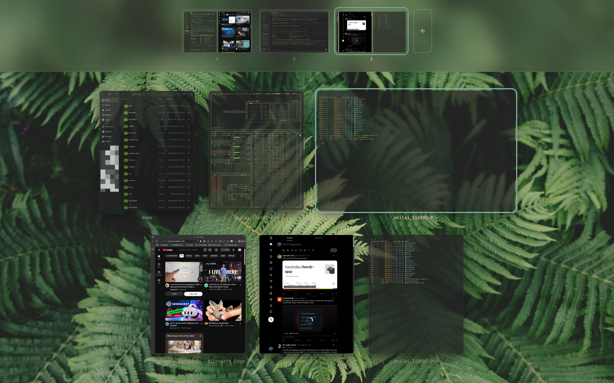

# Omaview



A window overview for [Omarchy](https://omarchy.org). One key shows every window
on the screen spread out side by side, with your workspaces along the top.
Click a window to jump to it, click a workspace to switch, drag a window onto
a workspace to move it there.

Omaview is an Omarchy shell plugin (`shilai_li.omaview`): QML running inside
the `omarchy-shell` process that is already running, not a Hyprland plugin, so
Hyprland updates do not break it.

> Status: multiple monitors and the four-finger swipe are written but have not
> been tried yet.

## Install

```bash
omarchy plugin add https://github.com/shilai-li/omaview.git
omarchy plugin enable shilai_li.omaview
```

**Enabling changes your Hyprland config.** As the shell starts, each time, the
plugin copies `hypr/omaview.lua` over `~/.config/hypr/omaview.lua`, adds
`require("hypr.omaview")` to `~/.config/hypr/bindings.lua`, and runs
`hyprctl reload` if either changed. That binds a tap on Super and replaces
Super+Q, Super+W, Super+Alt+F, Super+Enter, Alt+Tab and Alt+Shift+Tab, including
any bindings of your own on those keys. If `bindings.lua` does not exist,
nothing is written and these shortcuts are not set up. To undo it, see
[Remove](#remove).

For development, link the checkout instead and rescan:

```bash
ln -s ~/Projects/omaview ~/.config/omarchy/plugins/shilai_li.omaview
omarchy-shell shell rescanPlugins
omarchy plugin enable shilai_li.omaview
```

## Use

Tap **Super** on its own to open or close the overview (Super with any other
key acts as before), or swipe up with four fingers. While the overview is
open, Super+Q/W, Super+Alt+F and Super+Enter act on the selected window, and
Alt+Tab moves the selection. On an empty workspace, Super+Enter opens a terminal
there.

To change a shortcut, edit the plugin's `hypr/omaview.lua`; the copy in
`~/.config/hypr` is replaced at each start.

| Key / mouse | Action |
|---|---|
| `Esc`, click on empty space | Close |
| Click a window, `Enter` | Focus it and close |
| Arrows / `h` `j` `k` `l`, `Tab`, `Alt`+`Tab` | Move the selection |
| Middle-click, `Delete` | Close the window |
| Click a workspace, `1`–`9` `0` | Switch to it |
| Drag a window onto a workspace, `Shift`+number | Move it there, silently |
| Drag a window onto another, `Shift`+arrows / `H` `J` `K` `L` | Swap their places in the layout |
| `+` tile, `n` | Add an empty workspace to the strip (`Shift`+`n` sends the selected window to a new one) |
| Middle-click a workspace | Remove it; its windows come to the one on screen |

Each monitor shows its own windows and workspaces; the keyboard goes to the
one that had focus when the overview opened.

## Remove

`omarchy plugin remove` deletes the plugin but not what it wrote to your
Hyprland config, so the Super tap and the replaced keys stay until you take
those out too. Run these in this order, plugin first, because an enabled plugin
writes them back at the next shell start:

```bash
omarchy plugin remove shilai_li.omaview
sed --follow-symlinks -i '/^-- Omaview: tap Super to open the overview\.$/d; /^require("hypr\.omaview")$/d' ~/.config/hypr/bindings.lua
rm -f ~/.config/hypr/omaview.lua
rm -rf "${XDG_STATE_HOME:-$HOME/.local/state}/omaview"
hyprctl reload
```

The reload brings back Omarchy's own bindings on those keys. Any binding of your
own that Omaview replaced returns too, if it is still in your config.
`omarchy plugin disable` leaves the same things behind; to clean up while
keeping the plugin installed, run the same steps with `omarchy plugin disable
shilai_li.omaview` as the first line.

## Development

```bash
bash test/layout-test.sh    # layout math, plain node
bash test/install-test.sh   # installing the shortcuts, in a throwaway HOME
omarchy-restart-shell       # keepLoaded survives rescanPlugins; restart to load edits
```

## License

MIT
